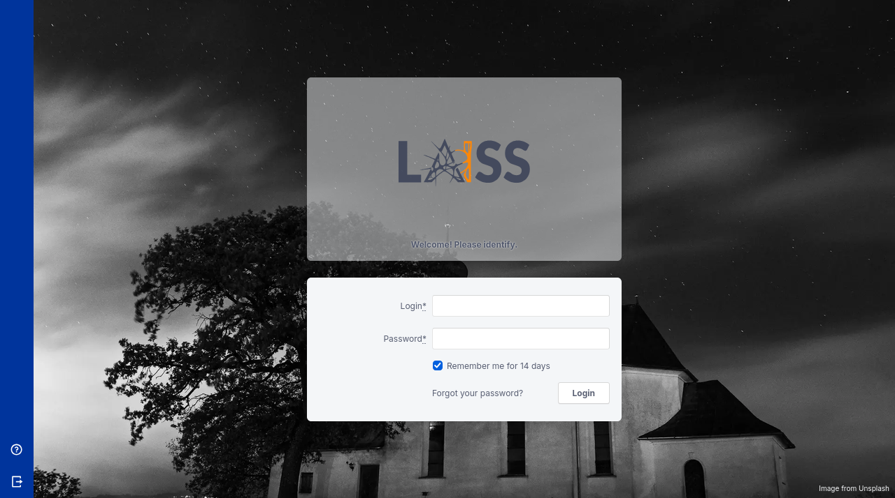
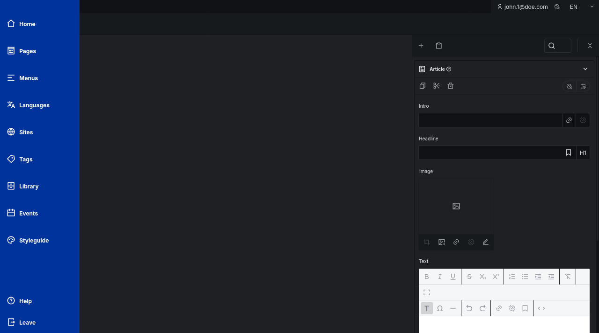

# laiss-rails-cms

A private, in-house CMS engine for Rails, maintained by **Laiss Labs** and
developed by **Júlio Papel**.

laiss-rails-cms is a semantically structured, full-featured CMS engine: page
trees with versioning, elements and ingredients for content modelling, a
multi-language and multi-site admin, a REST API, and a rich admin interface with
live preview.

> [!IMPORTANT]
> This is a **private fork**, not a public product. It is **not published to
> RubyGems** and has no public support channels. It is installed from this
> repository as a `path:` or `git:` dependency. There is no release process, no
> versioned gem on rubygems.org, and no changelog published anywhere but this
> repository.

## Screenshots

| Dashboard | Element editor |
| --- | --- |
|  |  |

| Login | Dark theme |
| --- | --- |
|  |  |

## Requirements

| Requirement | Version |
| --- | --- |
| Ruby | >= 3.1 |
| Rails | >= 7.2, < 8.2 |
| Database | SQLite, PostgreSQL, MySQL or MariaDB |
| Node.js | 24.x (only to build the admin assets) |
| pnpm | 11.14 (only to build the admin assets) |

## Installation

Add the engine to your application's `Gemfile` as a path or git dependency.
There is no published gem to fetch.

```ruby
# From a local checkout
gem "laiss_cms", path: "/path/to/laiss-rails-cms"

# Or from a git remote
gem "laiss_cms", git: "git@github.com:laisslabs/laiss-rails-cms.git", branch: "main"
```

The English translations ship with the core gem. Other locales live in the
sibling `i18n/` gem, and Devise-based authentication in `devise/`; add them the
same way if you need them:

```ruby
gem "laiss_cms_i18n", path: "/path/to/laiss-rails-cms/i18n", require: false
gem "laiss-cms-devise", path: "/path/to/laiss-rails-cms/devise", require: false
```

Then install the engine and its migrations:

```bash
bundle install
bin/rails laiss_cms:install
bin/rails db:migrate
```

The install generator creates `config/laiss_cms/` with the element, page layout
and menu definitions your app starts from, plus an initializer.

## Configuration

Engine configuration lives in `config/initializers/laiss_cms.rb`. For example:

```ruby
LaissCms.configure do |config|
  config.user_class = "User"
  config.admin_path = "admin"
end
```

Content definitions — page layouts, elements and menus — are YAML files in
`config/laiss_cms/`. See the guides for the full reference.

## Development

This repository is the engine itself, with a dummy Rails application under
`spec/dummy` for development and tests.

```bash
bundle install
pnpm install --frozen-lockfile
pnpm run build

RAILS_ENV=test bundle exec rake laiss_cms:test:prepare
bin/rspec spec
bin/rspec devise/spec
```

Toolchain versions are pinned in `.tool-versions`; see
[docs/development/toolchain-pinning.md](docs/development/toolchain-pinning.md)
for why, and what the expected test counts are.

Assets are built with pnpm and committed under `app/assets/builds/`, because the
engine's consumers load them through Propshaft without a Node toolchain of their
own. Run `pnpm run build` after changing anything in `app/javascript` or
`app/stylesheets`.

## Documentation

The `guides/` directory holds the reference documentation:

- `getting_started.md` — first page, layouts, elements
- `elements.md`, `ingredients.md` — content modelling
- `configuration.md` — every configuration option
- `extensions.md` — extending the admin
- `deployment.md`, `how_to_deploy_with_kamal.md` — deploying

## Licence

BSD-3-Clause. See [LICENSE](LICENSE).

The upstream copyright notices, licence conditions and disclaimer are retained
in the `LICENSE` files as BSD-3-Clause requires. Provenance is recorded there and
nowhere else in this repository.
