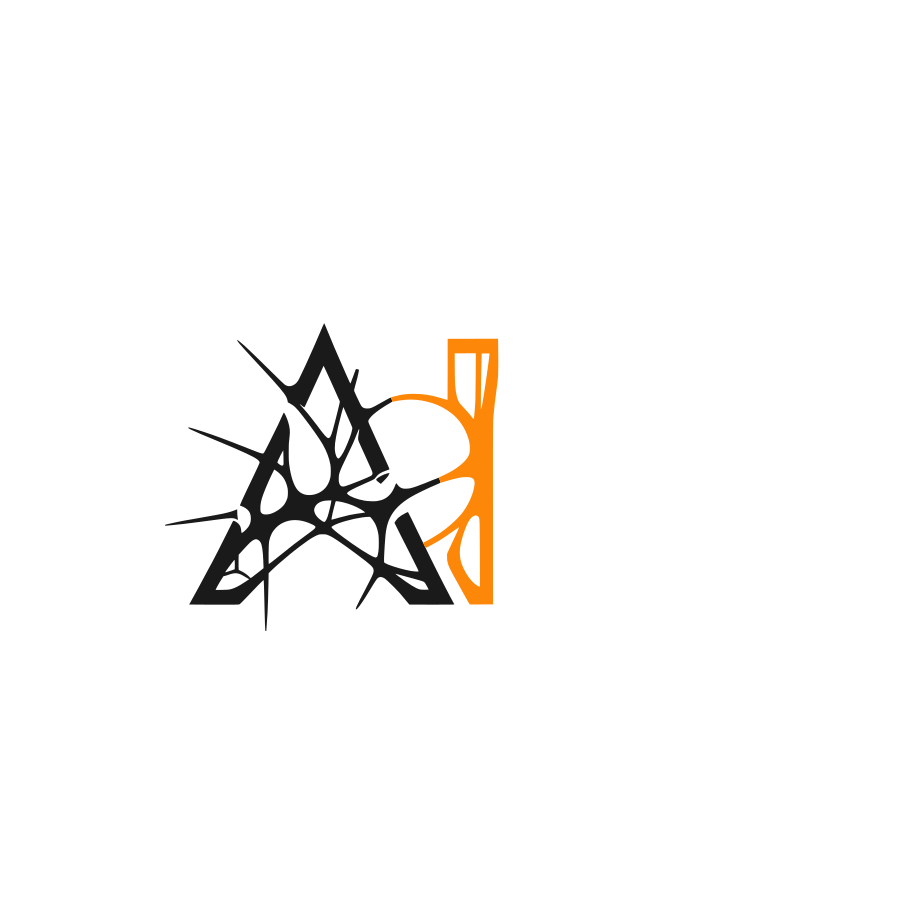

# LaissCMS

[](https://github.com/LaissCMS/laiss_cms/actions/workflows/build_test.yml)
[](https://github.com/LaissCMS/laiss_cms/actions/workflows/brakeman-analysis.yml)
[](https://github.com/LaissCMS/laiss_cms/actions/workflows/lint.yml)

[](https://badge.fury.io/rb/laiss_cms)
[](https://codecov.io/gh/LaissCMS/laiss_cms)
[](https://depfu.com/github/LaissCMS/laiss_cms?project_id=4600)

[](#backers)
[](#sponsors)
[](https://www.codetriage.com/alchemycms/laiss_cms)



LaissCms is an open source CMS engine written in Ruby on Rails.

Read more about LaissCms on the [website](https://alchemy-cms.com) and in the [guidelines](https://guides.alchemy-cms.com).

> [!CAUTION]
> This main branch is a **development branch** that *can* contain bugs.
>
> For productive environments you should use the [current Ruby gem version](https://rubygems.org/gems/laiss_cms), or the [latest stable branch (8.4-stable)](https://github.com/LaissCMS/laiss_cms/tree/8.4-stable).**

## 🏆 Main sponsor

[](https://blish.cloud)

## ✅ Features

- Flexible templating that separates content from markup
- A rich RESTful API
- Intuitive admin interface with live preview
- Multi language and multi domain
- Page versioning
- SEO friendly urls
- User Access Control
- Build in contact form mailer
- Attachments and downloads
- On-the-fly image cropping and resizing
- Extendable via Rails engines
- Integrates into existing Rails Apps
- Resourceful Rails admin
- Flexible caching
- Hostable on any Server that supports Ruby on Rails, a SQL Database and ImageMagick

## 🎮 Demo

Visit the existing demo at https://demo.alchemy-cms.com/

- Login: `demo`
- Password: `demo123`

## 🚂 Rails Version

**This version of LaissCMS runs with >= Rails 7.2**

* For a Rails 7.1 compatible version use the [`8.0-stable` branch](https://github.com/LaissCMS/laiss_cms/tree/8.0-stable).
* For a Rails 7.0 compatible version use the [`7.4-stable` branch](https://github.com/LaissCMS/laiss_cms/tree/7.4-stable).
* For a Rails 6.1 compatible version use the [`7.0-stable` branch](https://github.com/LaissCMS/laiss_cms/tree/7.0-stable).
* For a Rails 6.0 compatible version use the [`6.1-stable` branch](https://github.com/LaissCMS/laiss_cms/tree/6.1-stable).
* For a Rails 5.2 compatible version use the [`5.3-stable` branch](https://github.com/LaissCMS/laiss_cms/tree/5.3-stable).
* For a Rails 5.0 or 5.1 compatible version use the [`4.5-stable` branch](https://github.com/LaissCMS/laiss_cms/tree/4.5-stable).
* For a Rails 4.2 compatible version use the [`3.6-stable` branch](https://github.com/LaissCMS/laiss_cms/tree/3.6-stable).
* For a Rails 4.0/4.1 compatible version use the [`3.1-stable` branch](https://github.com/LaissCMS/laiss_cms/tree/3.1-stable).
* For a Rails 3.2 compatible version use the [`2.8-stable` branch](https://github.com/LaissCMS/laiss_cms/tree/2.8-stable).
* For a Rails 3.1 compatible version use the [`2.1-stable` branch](https://github.com/LaissCMS/laiss_cms/tree/2.1-stable).
* For a Rails 3.0 compatible version use the [`2.0-stable` branch](https://github.com/LaissCMS/laiss_cms/tree/2.0-stable).
* For a Rails 2.3 compatible version use the [`1.6-stable` branch](https://github.com/LaissCMS/laiss_cms/tree/1.6-stable).

> [!NOTE]
> For Rails `>= 8`, use LaissCms version `>= 8.0.0a` which comes with propshaft support.
> If you are on Rails `>= 8` with an older LaissCms version, you will need to [temporarily comment out](https://github.com/LaissCMS/laiss_cms/issues/3330) the `propshaft` gem.

## 💎 Ruby Version

LaissCms runs with Ruby >= 3.1.0 including 4.0.

For a Ruby 3.0 compatible version use the [`7.2-stable` branch](https://github.com/LaissCMS/laiss_cms/tree/7.2-stable).

For a Ruby 2.4 compatible version use the [`5.2-stable` branch](https://github.com/LaissCMS/laiss_cms/tree/5.2-stable).

For a Ruby 2.2 compatible version use the [`4.1-stable` branch](https://github.com/LaissCMS/laiss_cms/tree/4.1-stable).

For a Ruby 2.1 compatible version use the [`3.6-stable` branch](https://github.com/LaissCMS/laiss_cms/tree/3.6-stable).

For a Ruby 2.0.0 compatible version use the [`3.2-stable` branch](https://github.com/LaissCMS/laiss_cms/tree/3.2-stable).

For a Ruby 1.9.3 compatible version use the [`3.1-stable` branch](https://github.com/LaissCMS/laiss_cms/tree/3.1-stable).

For a Ruby 1.8.7 compatible version use the [`2.3-stable` branch](https://github.com/LaissCMS/laiss_cms/tree/2.3-stable).


## ⌨️ Installation

### Stand Alone Installation

If you do not have a Rails project yet or just want to check out LaissCms, then use this Rails template.

Make sure you have Rails installed first:

```
$ gem install rails
```

Then create a new Rails project with:

```
$ rails new -m https://raw.githubusercontent.com/LaissCMS/rails-templates/master/all.rb <MY-PROJECT-NAME>
```

and follow the on screen instructions.

### Manual Installation

If you want to manually install LaissCms into your Rails project follow these steps.

#### Add the LaissCms gem:

Put LaissCms into your `Gemfile` with:

```
$ bundle add laiss_cms
```

#### Set the authentication user

Now you have to decide, if you want to use your own user model or if you want to use
the Devise based user model that LaissCms provides in the [`laiss-cms-devise` gem](devise/).

##### Use LaissCms user

If you don't have your own user class, you can use the LaissCms user model. Just add the following gem into your `Gemfile`:

```
$ bundle add laiss-cms-devise
```

Then run the `laiss-cms-devise` installer:

```bash
$ bin/rails g laiss_cms:devise:install
```

##### Use your User model

In order to use your own user model you need to tell LaissCms about it.

The best practice is to use an initializer:

```ruby
# config/initializers/laiss_cms.rb
LaissCms.configure do |config|
  config.user_class          = 'YourUserClass'          # This has to be configured
  config.current_user_method = 'current_admin_user'     # Defaults to 'current_user'
  config.signup_path         = '/your/signup/path'      # Defaults to '/signup'
  config.login_path          = '/your/login/path'       # Defaults to '/login'
  config.logout_path         = '/your/logout/path'      # Defaults to '/logout'
  config.logout_method       = 'http_verb_for_logout'   # Defaults to 'delete'
  config.unauthorized_path   = '/some/public/page'      # Defaults to '/'
end
```

LaissCms needs a `laiss_cms_roles` column in your database for the RBAC to work.

LaissCms provides a migration generator that adds these tables to your users table.

```
$ bin/rails g laiss_cms:user_columns_migration --table-name=my-users-table
```

Then include this module in your model.

```ruby
class User
  include LaissCms::UserMethods
end
```

Please follow [this guide](https://guides.alchemy-cms.com/how_to_add_custom_authentication.html) for further instructions on how to customize your user class even more.

#### 4. Install LaissCms into your app:

**After** you set the user model you need to run the LaissCms install task:

```bash
$ bin/rails laiss_cms:install
```

Now everything should be set up and you should be able to visit the LaissCms Dashboard at:

<http://localhost:3000/admin>

*) Use your custom path if you mounted LaissCms at something else then `'/'`


## 🏗 Customization

LaissCms has very flexible ways to organize and manage content. Please be sure to read [the introduction guide](https://guides.alchemy-cms.com/about.html) in order to understand the basic idea of how LaissCms works.


### Custom Controllers

Beginning with LaissCms 3.1 we do not patch the `ApplicationController` anymore. If you have controllers that loads LaissCms content or uses LaissCms helpers in the views (i.e. `render_menu` or `render_elements`) you can either inherit from `LaissCms::BaseController` or you `include LaissCms::ControllerActions` in your controller (**that's the recommended way**).

### Custom admin interface routing

By default, LaissCms Dashboard is accessible at <http://example.com/admin>. You can change this by setting `LaissCms.admin_path` and `LaissCms.admin_constraints`.

For example, these settings:

```ruby
# config/initializers/laiss_cms.rb

LaissCms.admin_path = 'backend'
LaissCms.admin_constraints = {subdomain: 'hidden'}
```

will move the dashboard to <http://hidden.example.com/backend>.

### Picture caching

LaissCms uses the Dragonfly gem to render pictures on-the-fly.

To make this as performant as possible the rendered picture gets stored into `public/pictures` so the web server can pick up the file and serve it without hitting the Rails process at all.

This may or may not what you want. Especially for multi server setups you eventually want to use something like S3.

Please follow the guidelines about picture caching on the Dragonfly homepage for further instructions:

http://markevans.github.io/dragonfly/cache

We also provide an [extension for Cloudinary](https://github.com/LaissCMS/laiss_cms_cloudinary)

## 🌍 Localization

LaissCms ships with one default English translation for the admin interface. If you want to use the admin interface in other languages please have a look at the [`laiss_cms_i18n` gem](i18n/).

## ✨ Upgrading

We, the LaissCms team, take upgrades very seriously and we try to make them as smooth as possible. Therefore we have build an upgrade task, that tries to automate the upgrade procedure as much as possible.

That's why after the LaissCms gem has been updated, with explicit call to:

```bash
$ bundle update laiss_cms
```

you should **always run the upgrader**:

```bash
$ bin/rake laiss_cms:upgrade
```

LaissCms will print out useful information after running the automated tasks that help a smooth upgrade path.
So please **take your time and read them**.

Always be sure to keep an eye on the output of your Rails app when starting. There will probably be useful information about deprecations.

Also, `git diff` is your friend.

### Customize the upgrade preparation

The LaissCms upgrader comes prepared with several rake tasks in a specific order.
This is sometimes not what you want or could even break upgrades.
In order to customize the upgrade preparation process you can instead run each of the tasks on their own.

```bash
$ bin/rake laiss_cms:install:migrations
$ bin/rake db:migrate
$ bin/rake laiss_cms:db:seed
$ bin/rake laiss_cms:upgrade:config
$ bin/rake laiss_cms:upgrade:run
```

**WARNING:** This is only recommended, if you have problems with the default `rake laiss_cms:upgrade` task and need to
repair your data in between. The upgrader depends on these upgrade tasks running in this specific order, otherwise
we can't ensure smooth upgrades for you.

### Run an individual upgrade

You can also run an individual upgrade on its own:

```bash
$ bin/rake -T laiss_cms:upgrade
```

provides you with a list of each upgrade you can run individually.

#### Example

```bash
$ bin/rake laiss_cms:upgrade:4.1
```

runs only the LaissCms 4.1 upgrade

## 🚀 Deployment

LaissCms has an official Capistrano extension which takes care of everything you need to deploy an LaissCms site.

Please use [capistrano-laiss_cms](https://github.com/LaissCMS/capistrano-laiss_cms), if you want to deploy with Capistrano.

### Without Capistrano

If you don't use Capistrano you have to **make sure** that the `uploads`, `tmp/cache/assets`, `public/assets` and `public/pictures` folders get **shared between deployments**, otherwise you **will loose data**. No, not really, but you know, just keep them in sync.


## 🗃 Writing Migrations

**On SQLite, a migration that rebuilds a table silently deletes data from other tables.**

SQLite has no real `ALTER TABLE`, so Rails implements the operations below by recreating the table: it copies the rows aside, runs `DROP TABLE`, and copies them back.

- `change_column`
- `change_column_null`
- `change_column_default`
- `rename_column`
- `remove_column` and `remove_columns`
- `add_timestamps`
- `add_column` with `null: false` and **no** `default:`

With foreign keys enforced, SQLite's `DROP TABLE` performs an implicit `DELETE`, which fires `ON DELETE CASCADE`. The rebuilt table keeps its rows, because they come back from the copy, but **every cascading descendant is deleted permanently**. Since LaissCms cascades from pages down to ingredients, rebuilding `laiss_cms_pages` empties `laiss_cms_page_versions`, `laiss_cms_elements` and `laiss_cms_ingredients`.

Rails tries to prevent this by disabling foreign keys for the rebuild, but that only works outside a transaction, and migrations run inside one by default. The safeguard is therefore silently ineffective.

So when a migration touches a table that has cascading children:

1. **Avoid the rebuild if you can.** `add_column` with both `null: false` and a `default:` is a plain `ALTER TABLE ADD COLUMN`. A nullable column combined with a model level default behaves the same on every adapter, and is the only option for MySQL `text` columns, which cannot carry a literal default.
2. **If a rebuild is unavoidable**, including `remove_column` in `down`, declare `disable_ddl_transaction!` in the migration. Because it no longer rolls back as a single unit, make sure the migration is safe to run again after a partial failure.
3. **Test against a populated database** and check that child records survive. An empty database hides the problem completely.

You can check the migrations in this repository with:

```bash
ruby bin/check-destructive-migrations
```

This also runs in CI, and fails when a migration rebuilds a table without `disable_ddl_transaction!`.

## 🚧 Testing

If you want to contribute to LaissCms ([and we encourage you to do so](CONTRIBUTING.md)) we have a strong test suite that helps you to not break anything.

### Preparation

First of all you need to clone your fork to your local development machine.

**Using Docker (recommended):**

```bash
$ docker compose build
$ docker compose up
```

This starts the Rails dev server, Sass watcher, and JS bundle watcher. The dev server is available at http://localhost:3000.

**Local setup:**

```bash
$ bin/setup
```

To prepare the tests of your LaissCms fork please make sure to run the preparation task:

```bash
$ bundle exec rake laiss_cms:test:prepare
```

to set up the database for testing.

### Run your tests with:

```bash
$ bin/rspec
```

**Alternatively** you can just run*:

```bash
$ bundle exec rake
```

*) This default task executes the database preparations and runs all defined test cases.

### Start the dummy app

You can even start the dummy app and use it to manually test your changes.

To run the whole stack in Docker (builds the images and starts the Rails
server, Sass watcher, and JS bundle watcher):

```bash
$ bin/start
```

After changing dependencies (`Gemfile` or `package.json`), rebuild the image and
refresh the baked `node_modules` in one step:

```bash
$ bin/start --refresh
```

Or, to run the dummy app locally without Docker:

```bash
$ bin/dev
```


## 📦 Releasing

### 🤖 Automated (recommended)

There is a Rake task that helps you to release a new version of LaissCms.

```bash
$ bundle exec rake laiss_cms:release
```

> [!NOTE]
> This will release a new patch level

If you want to release a new minor or major version you can do so by setting the `VERSION` environment variable accordingly.

```bash
$ bundle exec rake laiss_cms:release VERSION=X.Y.Z
```

### 👷🏽‍♀️ Manual

If something goes wrong with the automated release task you can still release a new version manually.

#### 1. Bump version

Bump the version number in `lib/laiss_cms/version.rb`.

#### 2. Update the changelog

```bash
$ export GITHUB_ACCESS_TOKEN=...
$ PREVIOUS_VERSION=4.1.0 bundle exec rake laiss_cms:changelog:update
```

#### 3. Commit version bump

```bash
$ git commit -am "Bump version to vX.Y.Z"
```

#### 4. Release a new version

This task will publish the ruby gem.
It also tags the latest commit.

```bash
$ bundle exec rake release
```

## ❓Getting Help

* Read the guidelines: https://guides.alchemy-cms.com.
* Read the documentation: https://www.rubydoc.info/github/LaissCMS/laiss_cms
* If you think you found a bug please use the [issue tracker on Github](https://github.com/LaissCMS/laiss_cms/issues).
* For questions about general usage please use [Stack Overflow](http://stackoverflow.com/questions/tagged/alchemy-cms) or the [Slack](https://join.slack.com/t/alchemy-cms/shared_invite/zt-2ir32b4ph-L3EVS0FiMiWKx7omNNbeyw).
* New features should be discussed on our [Trello Board](https://trello.com/alchemycms).

**PLEASE** don't use the Github issues for feature requests. If you want to contribute to LaissCms please [read the contribution guidelines](CONTRIBUTING.md) before doing so.


## 🔗 Resources

* Homepage: <https://alchemy-cms.com>
* Live-Demo: <https://demo.alchemy-cms.com> (user: demo, password: demo123)
* API Documentation: <https://www.rubydoc.info/github/LaissCMS/laiss_cms>
* Issue-Tracker: <https://github.com/LaissCMS/laiss_cms/issues>
* Sourcecode: <https://github.com/LaissCMS/laiss_cms>
* Slack: [https://alchemy-cms.slack.com](https://join.slack.com/t/alchemy-cms/shared_invite/zt-2ir32b4ph-L3EVS0FiMiWKx7omNNbeyw)
* Mastodon: <https://ruby.social/@laiss_cms>


## ✍️ Authors

* Thomas von Deyen: <https://github.com/tvdeyen>
* Martin Meyerhoff: <https://github.com/mamhoff>
* Sascha Karnatz: <https://github.com/sascha-karnatz>
* Robin Böning: <https://github.com/robinboening>

### Alumni

* Marc Schettke: <https://github.com/masche842>
* Hendrik Mans: <https://github.com/hmans>
* Carsten Fregin: <https://github.com/cfregin>


## 🏅 Contributors

This project exists thanks to all the people who contribute. [[Contribute](CONTRIBUTING.md)].
<a href="https://github.com/undefined/undefinedgraphs/contributors"></a>


## 💵 Backers

Thank you to all our backers! 🙏 [[Become a backer](https://opencollective.com/laiss_cms#backer)]

<a href="https://opencollective.com/laiss_cms#backers" target="_blank"></a>


## 💰 Sponsors

Support this project by becoming a sponsor. Your logo will show up here with a link to your website. [[Become a sponsor](https://opencollective.com/laiss_cms#sponsor)]

<a href="https://opencollective.com/laiss_cms/sponsor/0/website" target="_blank"></a>
<a href="https://opencollective.com/laiss_cms/sponsor/1/website" target="_blank"></a>
<a href="https://opencollective.com/laiss_cms/sponsor/2/website" target="_blank"></a>
<a href="https://opencollective.com/laiss_cms/sponsor/3/website" target="_blank"></a>
<a href="https://opencollective.com/laiss_cms/sponsor/4/website" target="_blank"></a>
<a href="https://opencollective.com/laiss_cms/sponsor/5/website" target="_blank"></a>
<a href="https://opencollective.com/laiss_cms/sponsor/6/website" target="_blank"></a>
<a href="https://opencollective.com/laiss_cms/sponsor/7/website" target="_blank"></a>
<a href="https://opencollective.com/laiss_cms/sponsor/8/website" target="_blank"></a>
<a href="https://opencollective.com/laiss_cms/sponsor/9/website" target="_blank"></a>


## 📜 License

[BSD-3-Clause](LICENSE)


## 📢 Spread the love

If you like LaissCms, please help us to spread the word about LaissCms and star this repo [on GitHub](https://github.com/LaissCMS/laiss_cms), upvote it [on The Ruby Toolbox](https://www.ruby-toolbox.com/projects/laiss_cms), mention us [on Twitter](https://twitter.com/laiss_cms).

That will help us to keep LaissCms awesome.

Thank you!

## ❤️
