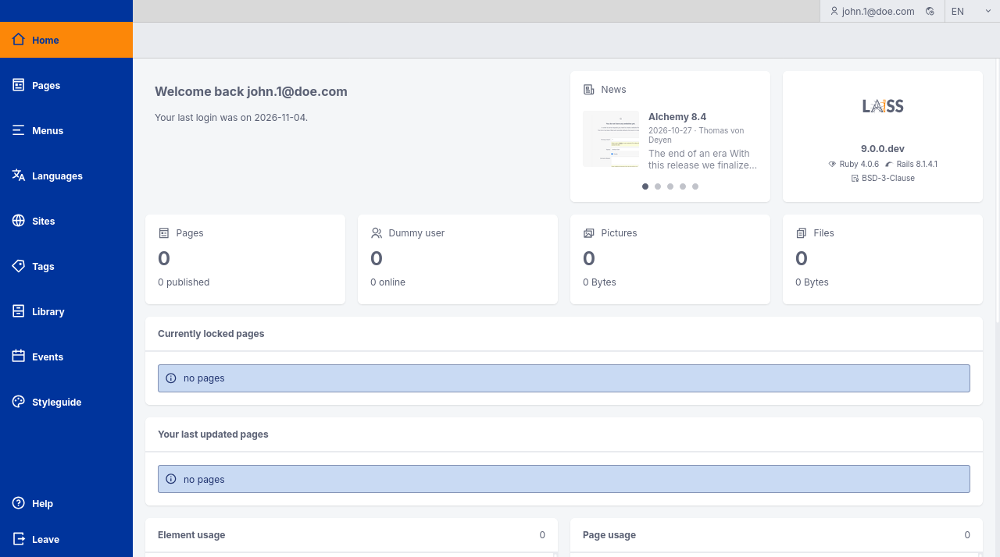
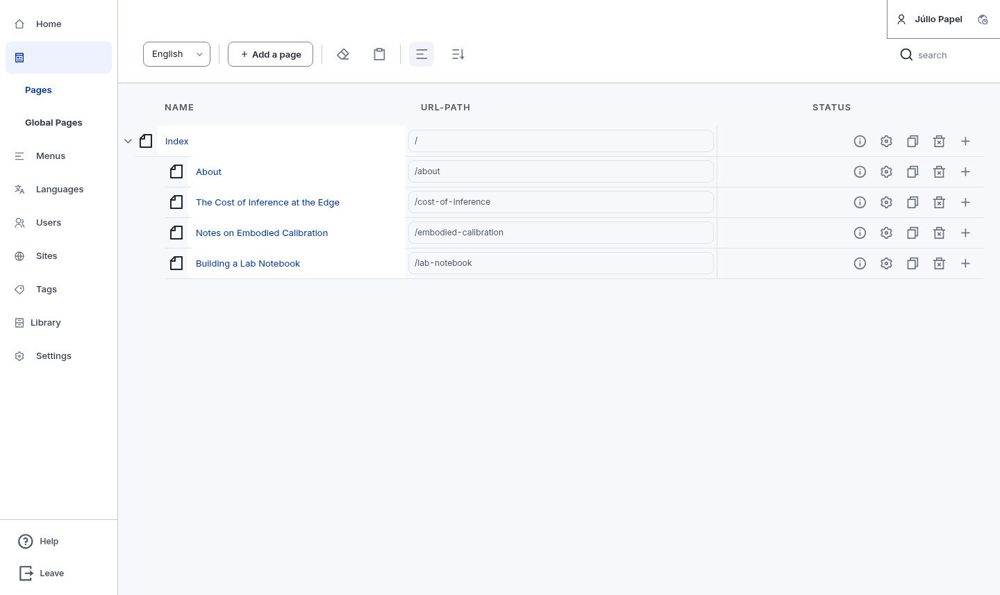
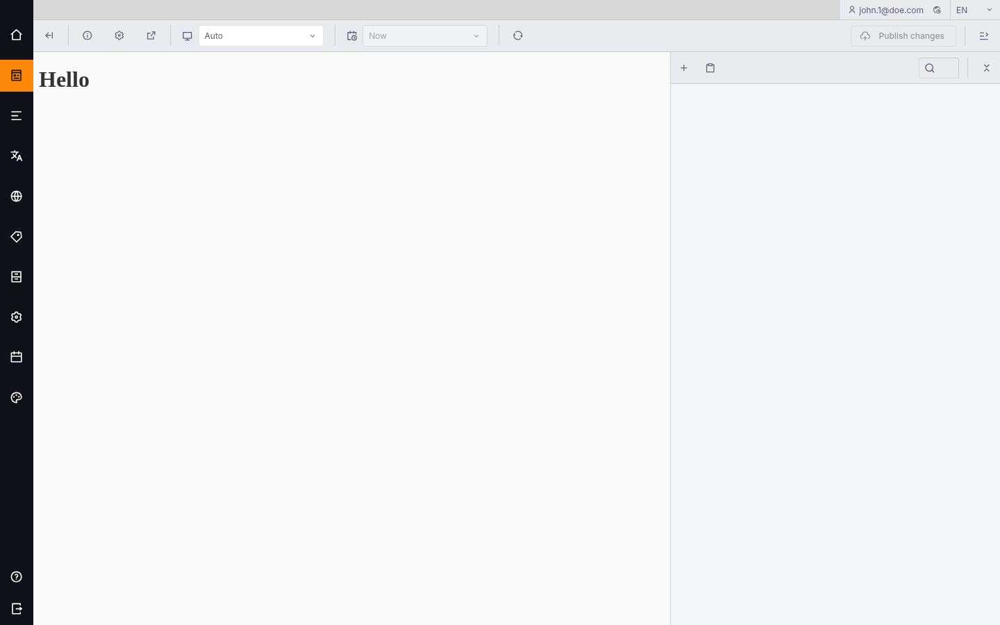
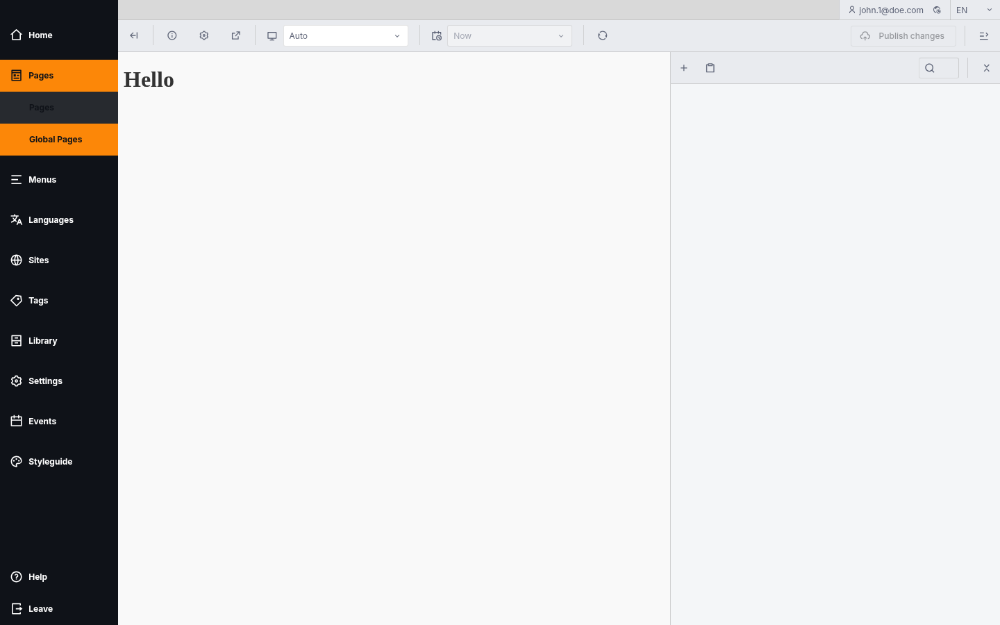
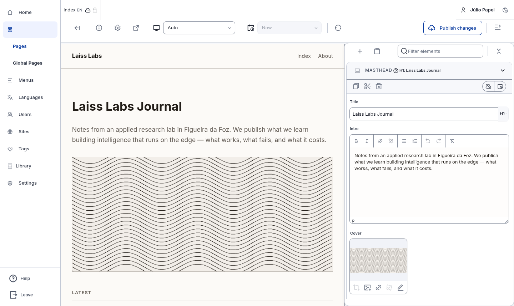
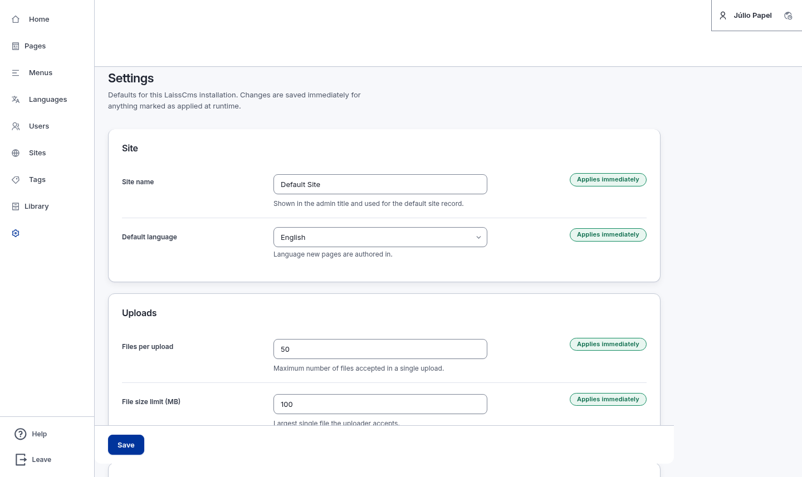
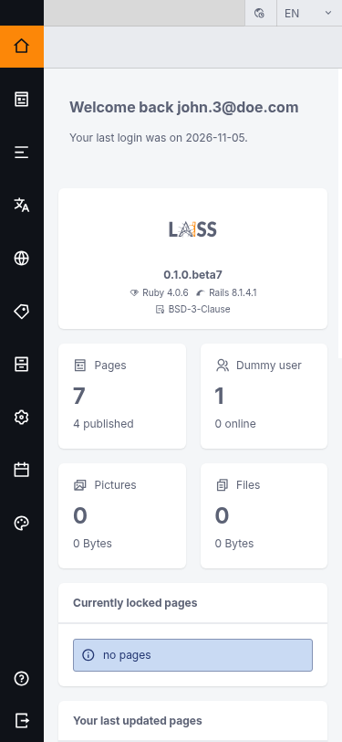
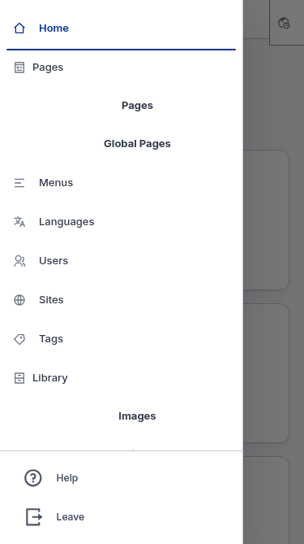

# laiss-rails-cms

A CMS engine for Rails, made by **Laiss Labs**.

Content is modelled as **pages** built from **elements**, and each element has
typed **ingredient** fields. Layout and hierarchy live in element definitions, not
in what a writer types — so an author cannot break the structure of a page.

> [!IMPORTANT]
> This is **not published to RubyGems** and never will be. Install it from git at
> a tag. There is no gem on rubygems.org and no support contract.

Current version: **0.1.0.beta2**. See [docs/versioning.md](docs/versioning.md) —
this project has its own version sequence, deliberately unrelated to any other
CMS's numbering.

## What it does

- **Page trees** with versioning, drafts, publication scheduling and locking, so
  two people cannot edit one page at once.
- **Elements and ingredients** for content modelling: a page is a list of elements,
  an element is a set of typed fields.
- **Multi-language and multi-site** from one installation.
- **A REST API** for reading published content.
- **An admin interface** with live preview, a structured element editor, and a
  settings screen for real engine configuration.

## Screenshots

All captured from this build.

| Dashboard | Pages |
| --- | --- |
|  |  |

The page editor collapses the sidebar so the canvas gets the width, and the
toggle brings it back:

| Editor, sidebar collapsed | Editor, sidebar expanded |
| --- | --- |
|  |  |

| Element editor | Settings |
| --- | --- |
|  |  |

Mobile: the sidebar becomes a drawer.

| Dashboard | Drawer open |
| --- | --- |
|  |  |

## Requirements

| Requirement | Version |
| --- | --- |
| Ruby | `>= 3.1` (development pins 4.0.6) |
| Rails | `>= 7.2, < 8.2` |
| Database | SQLite, PostgreSQL, MySQL or MariaDB |
| Node.js | 24.x — only to build assets from source |
| pnpm | 11.14 — only to build assets from source |

ActiveStorage is required: images are stored through it.

## Installation

Add the engine to your `Gemfile` at a tag. The built assets are committed, so a
git install needs no Node toolchain.

```ruby
gem "laiss_cms",
  git: "git@github.com:JulioPapel/laiss-rails-cms.git",
  tag: "v0.1.0.beta2"

# Optional: Devise-based authentication.
# The integration ships inside laiss_cms; only the devise gem is separate, and it
# stays optional. Skip this pair if the host app brings its own sign-in.
gem "devise", "~> 4.9"
```

There is one gem. The translations for every supported locale and the devise
integration are both part of `laiss_cms`.

Authentication is opt-in: add it to `config/application.rb` after the engine is
required.

```ruby
require "laiss_cms"
require "laiss_cms/devise"   # only if using the bundled sign-in
```

Without that line there is no `LaissCms::User`, no sign-in routes and no admin
user screen — and the rest of the CMS works normally.

Then run these **in this order**:

```bash
bundle install
bin/rails active_storage:install        # REQUIRED — image upload fails without it
bin/rails laiss_cms:install             # config, migrations, mount, demo files
bin/rails g laiss_cms:devise:install    # only if using the bundled sign-in
bin/rails db:migrate
bin/rails db:seed                       # REQUIRED — creates the site, the default
                                        # language and the root page
```

Two steps are easy to miss and both fail quietly:

- **`active_storage:install`.** The engine boots without it, but every image
  upload fails because the tables do not exist.
- **`db:seed`.** The installer appends `LaissCms::Seeder.seed!` to `db/seeds.rb`
  but does not run it. Without it there is no site, no language and no root page,
  so the admin shows an empty tree and pages cannot be created (a page needs a
  parent).

`laiss_cms:install` also writes a starter `db/seeds/laiss_cms/pages.yml`, so a
fresh install seeds a two-page tree (Index with an About child) without any further
work. Edit that file to change the structure:

```yaml
# db/seeds/laiss_cms/pages.yml
- name: Index
  urlname: index
  page_layout: index
  title: Welcome
  children:
    - name: About
      urlname: about
      page_layout: index
      title: About
```

If the file is missing, `db:seed` prints the path it looked for and creates no
pages — it is not a silent no-op.

If the admin raises `NoCurrentUserFoundError`, the authentication integration is
not loaded. Either add `require "laiss_cms/devise"` to `config/application.rb`
(see [installation](#installation) above), or define `current_user` yourself if
you are bringing your own sign-in.

## Configuration

Engine options live in `config/initializers/laiss_cms.rb`:

```ruby
LaissCms.configure do |config|
  config.user_class = "User"
  config.items_per_page = 25
end

LaissCms.admin_path = "backend"   # set on the module, not inside the block
```

Content definitions — page layouts, elements, menus — are YAML in
`config/laiss_cms/`. See [guides/configuration.md](guides/configuration.md).

Many settings are also editable at runtime from the admin's **Settings** screen;
those persist across restarts. Fields that are consumed at boot are shown
read-only and labelled as such.

## The concepts

**Page → element → ingredient.** A page is a node in a tree with a URL, a language
and a page layout. Its content is an ordered list of elements. Each element is a
type declared in `elements.yml`, and its fields ("ingredients") are typed: text,
richtext, picture, link, select, boolean, datetime, and so on.

Because the element definition declares which fields exist and how they render, a
writer fills in fields rather than composing a layout. That is the whole point:
the structure is guaranteed by the code, not by discipline.

- [guides/elements.md](guides/elements.md) — elements and page layouts together
- [guides/ingredients.md](guides/ingredients.md)
- [guides/pages.md](guides/pages.md)

## The rich-text editor

Body fields are **intentionally limited** to inline formatting and lists: bold,
italic, link, lists, blockquote, inline code, undo/redo, clear formatting.

Headings, sizes and alignment are not available, because hierarchy comes from the
element definition. Tables, colours, fonts, alignment, media insertion and source
view are removed, and `valid_elements` strips anything outside the allowed set even
on paste. Paste is plain text.

If you extend that set, add a matching rule to
`app/stylesheets/laiss_cms/body-copy.scss` so published content is styled.

## Guides

`guides/` is the reference documentation:

- [Getting started](guides/getting_started.md) — a real walkthrough
- [Elements and page layouts](guides/elements.md), [ingredients](guides/ingredients.md)
- [Configuration](guides/configuration.md), [i18n](guides/i18n.md),
  [deployment](guides/deployment.md)
- [Development](docs/development/) — suites, gates, the naming contract
- [Versioning](docs/versioning.md), [site sync](docs/site-sync.md)

## Development

This repository is the engine, with a dummy Rails app under `spec/dummy`.

```bash
bundle install
pnpm install --frozen-lockfile
pnpm run build

RAILS_ENV=test bundle exec rake laiss_cms:test:prepare
bundle exec rspec spec
bundle exec rspec devise/spec
pnpm exec vitest --run
script/rebrand/gates        # everything, with the baseline counts
```

Toolchain versions are pinned in `.tool-versions`. See
[CONTRIBUTING.md](CONTRIBUTING.md) for the naming contract, the rebrand tooling
and the commit conventions.

## Licence

BSD-3-Clause. See [LICENSE](LICENSE).

This engine derives from another CMS. The upstream copyright notices and licence
conditions are retained in the `LICENSE` files, which is what BSD-3-Clause
requires. That is the only place the derivation is recorded.
